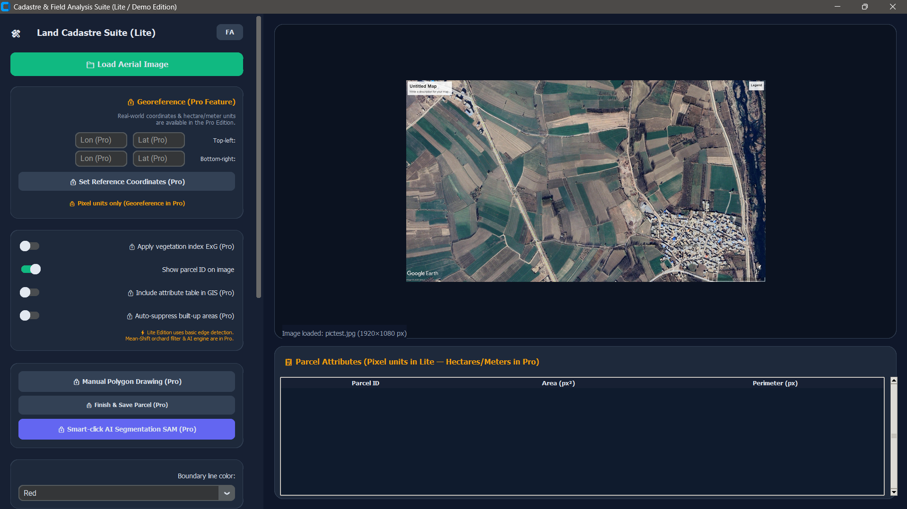

# CadastreVision
🌍 Agricultural Parcel Boundary Extraction &amp; Cadastre Suite (Python / CustomTkinter / OpenCV / GIS) — سامانه هوشمند استخراج مرز اراضی کشاورزی

# 🌍 CadastreVision — Agricultural Parcel Boundary Extraction Suite (Lite / Demo Edition)

**سامانه هوشمند استخراج مرز اراضی کشاورزی و کاداستر از تصاویر هوایی و ماهواره‌ای**

A modern desktop GIS & Computer Vision application built with **Python + CustomTkinter** for semi-automatic extraction of agricultural parcel boundaries from aerial/satellite imagery.

> 💡 **Repository Notice:** This repository contains the **Lite (Demo) Edition** of CadastreVision, intended as a portfolio showcase and interactive UI preview. For commercial survey-grade accuracy, AI segmentation, and direct GIS exports, see the **Pro Edition** comparison table below.

---

## ✨ Lite vs. Pro Edition Comparison (مقایسه نسخه دمو و نسخه تجاری Pro)

| Feature / قابلیت | Lite Edition (GitHub Demo) | Pro Edition (نسخه کامل تجاری) |
| :--- | :---: | :---: |
| **Bilingual Modern UI (رابط کاربری دوزبانه فارسی/انگلیسی)** | ✅ Full UI Preview | ✅ Active |
| **Detection Engine (موتور پردازش تصویر)** | Basic Canny Edge | 🚀 **Mean-Shift + ExG + Shape Sanity Filter** |
| **Orchard & Canopy Smoothing (حذف نویز بافت درختان و باغات)** | ❌ No (Jagged on dense trees) | ✅ **Yes (Smooth region boundaries)** |
| **Built-up & Rooftop Suppression (حذف خودکار مناطق مسکونی)** | 🔒 Locked | ✅ **Smart Density + ExG Heuristic** |
| **Meta SAM AI Smart-Click (برش هوشمند تک‌کلیکی با هوش مصنوعی)** | 🔒 Locked | ✅ **One-Click AI Parcel Segmentation** |
| **Interactive Manual Drawing (ترسیم و اصلاح دستی چندضلعی‌ها)** | 🔒 Locked | ✅ **Unlimited Vertex Polygon Drawing** |
| **Georeferencing & UTM Projection (ژئورفرنس و محاسبه مساحت هکتاری)** | 🔒 Pixel Units Only (`px²`) | ✅ **Real Coordinates + Auto-UTM (`ha`, `m`)** |
| **GIS Spatial Exports (`Shapefile`, `GeoJSON`, `GPKG`, `KML/KMZ`)** | 🔒 Locked | ✅ **Full Export with Attribute Table** |
| **Engineering Reports (`Excel .xlsx` & `PDF Map Report`)** | 🔒 Locked | ✅ **Full Statistical & Map Reports** |
| **Annotated Image Export (ذخیره تصویر مرزبندی‌شده)** | ✅ Active (With Demo Watermark) | ✅ **High-Res (No Watermark)** |

---

## 🧠 Why does the Pro Edition perform drastically better on real farms?

In the **Lite Edition** (`detection.py`), parcel extraction relies on standard Gaussian smoothing + Canny edge detection. On real aerial imagery of orchards or dense crops, basic Canny reacts to individual tree canopies and shadows, producing fragmented or jagged contours.

In the **Pro Edition**, the proprietary pipeline resolves these real-world remote-sensing challenges:
1. **Excess Green Index (`ExG = 2G - R - B`) Blending:** Enhances crop-to-soil contrast before segmentation.
2. **Spatial-Color Mean-Shift Filtering:** Homogenizes internal orchard textures while keeping outer field boundaries razor-sharp.
3. **Geometric Solidity & Extent Filtering:** Eliminates border slivers and non-parcel artifacts.
4. **Built-up Cluster Suppression:** Automatically filters out rural village rooftops and streets without deleting isolated fallow fields.
5. **Segment Anything Model (SAM) Integration:** Allows instant 1-click AI boundary tracing for subtle bare-soil borders.

---

## 🚀 Quick Start (نصب و اجرای نسخه دمو)

```bash
git clone [https://github.com/mogtderi/CadastreVision.git](https://github.com/mogtderi/CadastreVision.git)
cd CadastreVision
pip install -r requirements.txt
python aturtarsim.py
